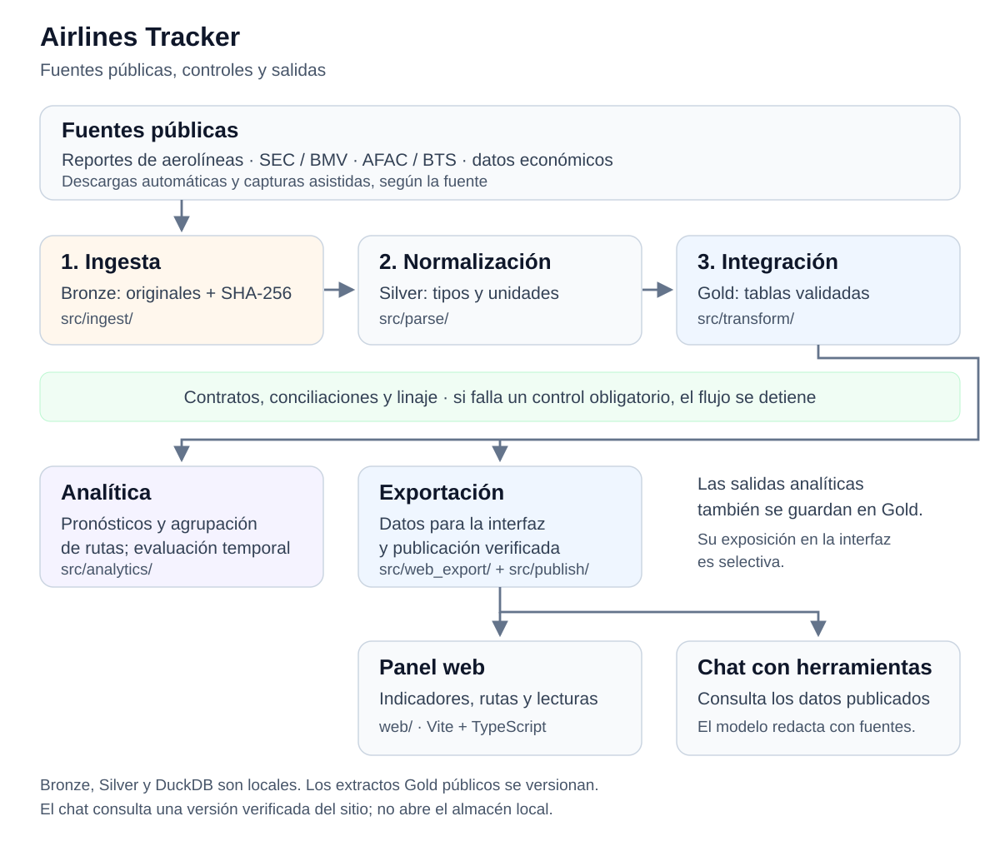

# Airlines Tracker

**Datos públicos para entender la industria aérea mexicana.**

Airlines Tracker reúne información de Aeroméxico, Volaris y Viva para explorar
su tráfico, rutas y desempeño financiero. Combina un dashboard interactivo,
flujos reproducibles de datos y un chat que consulta cifras y fuentes del proyecto.

La capa analítica incluye pronósticos de pasajeros, agrupación de rutas y
detección de anomalías. Es un proyecto independiente de portafolio, construido
con fuentes regulatorias, reportes de aerolíneas y datos económicos.

**[Abrir el dashboard](https://salvamalfa.github.io/aeromexico-tracker/)** ·
[Explorar el código](REPO_MAP.md) · [Ejecutar una copia local](#ejecutar-localmente)


*Vista de Mercado en 3T26. El selector de trimestre y las notas de cobertura
permiten identificar el periodo de cada consulta.*

## Qué puedes explorar

- **Lectura ejecutiva:** qué cambió en el trimestre y qué factores ayudan a explicarlo,
  con referencias a las fuentes.
- **Mercado:** tráfico de pasajeros, participación y rutas, con filtros geográficos.
- **Economía unitaria:** ingresos, costos y margen por capacidad ofrecida;
  las definiciones acompañan a los indicadores.
- **Noticias y chat:** consultar el archivo de noticias o hacer preguntas sobre
  los datos publicados. El chat requiere acceso al servicio configurado.

## Cómo está construido



| Componente | Qué aporta | Dónde revisarlo |
|---|---|---|
| Flujo de datos | Descarga, normalización y validación; conserva procedencia, hashes y recibos de ejecución. | [Pipeline](src/pipeline/README.md) |
| Pronósticos y aprendizaje automático | SARIMA y ETS frente a referencias simples; KMeans para agrupar rutas y controles de estabilidad. | [Métodos y evaluación](src/analytics/README.md) |
| Interfaz conversacional | El modelo usa herramientas de consulta sobre una versión fija de los datos; las respuestas incluyen referencias. | [Guía del chat](docs/chat/README.md) |
| Dashboard | Python prepara los datos; TypeScript, Vite y Plotly presentan las vistas en GitHub Pages. | [Interfaz y desarrollo](web/README.md) |

Los modelos se evalúan y calculan en la capa analítica. El dashboard actual
no incluye una gráfica interactiva de pronósticos. La documentación de modelos
permite revisar su evaluación por separado.

## Ejecutar localmente

Para explorar la copia publicada necesitas Git y Python 3:

```bash
git clone https://github.com/salvamalfa/aeromexico-tracker.git
cd aeromexico-tracker
python -m http.server 8000 --bind 127.0.0.1 --directory site
```

Abre **http://127.0.0.1:8000/**. Esta opción sirve los archivos incluidos en
el repositorio y no reconstruye los datos ni necesita claves de API.
El servicio de chat se configura por separado.

Para modificar la interfaz o reconstruir el flujo, sigue la
[guía de desarrollo](docs/cloud-development.md). El procesamiento usa Python 3.13;
algunas reconstrucciones requieren originales y expedientes fuera del repositorio público.

## Fuentes y límites

Las fuentes incluyen la autoridad aeronáutica mexicana (AFAC), BTS de Estados Unidos,
reportes financieros, SEC, BMV, Banxico y EIA. El
[catálogo de fuentes](docs/catalogo-fuentes-calendario.md) explica su cobertura.

- Cada fuente tiene su propio corte y alcance. El sitio indica cobertura parcial
  cuando corresponde; un faltante no se interpreta como cero.
- Los datos reportados y las estimaciones conservan su identificación.
  Las comparaciones requieren el mismo periodo, unidad y universo.
- El código automatiza el procesamiento, pero algunas descargas requieren asistencia.
  El monitor de GitHub comprueba frescura y calidad; la publicación tiene su propio control.

Consulta el [alcance de cada vista](docs/periodos-dashboard.md), el
[diccionario de datos](docs/diccionario-datos.md) y el
[glosario de indicadores](docs/glosario-kpis.md).
Los cambios y pendientes están en [CHANGELOG](CHANGELOG.md) y [ROADMAP](ROADMAP.md).

## Licencia

El código del proyecto se distribuye con [licencia MIT](LICENSE).
Los datos, documentos y materiales de terceros conservan sus licencias y condiciones
de origen. Airlines Tracker no es un producto oficial de las aerolíneas ni ofrece asesoría de inversión.

## Cómo funciona el chat

Estos recorridos explican el flujo base en un simulador. Los límites y cantidades
de herramientas mostrados son ilustrativos; la configuración vigente se describe
en la [guía técnica del chat](docs/arquitectura/airline-tracker-agents-api.md).

**De la pregunta a la respuesta:** cómo intervienen el modelo, las herramientas y los datos.


[Ver resumen estático](docs/assets/chat/anatomia-chat-resumen.png) ·
[Abrir el código de la versión interactiva](docs/arquitectura/anatomia-chat.html)

**Una llamada a herramientas:** cómo se consulta y devuelve la evidencia.


[Ver resumen estático](docs/assets/chat/anatomia-herramientas-resumen.png) ·
[Abrir el código de la versión interactiva](docs/arquitectura/anatomia-herramientas.html)

GitHub muestra los HTML como código. Descárgalos y ábrelos en un navegador para
explorar sus escenarios.
