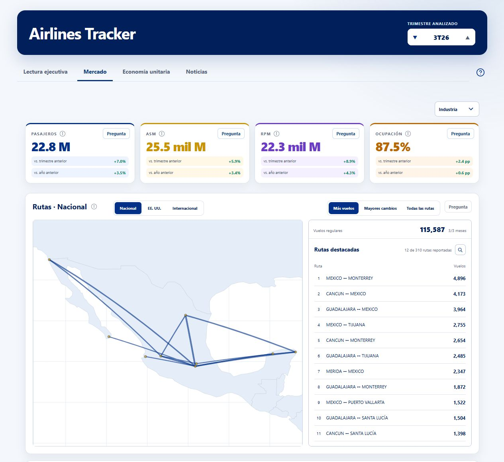
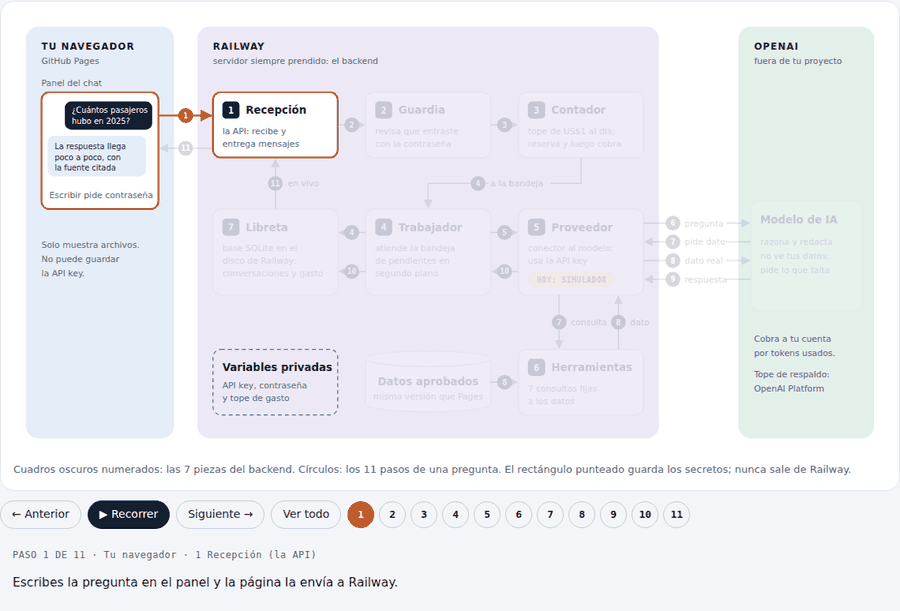
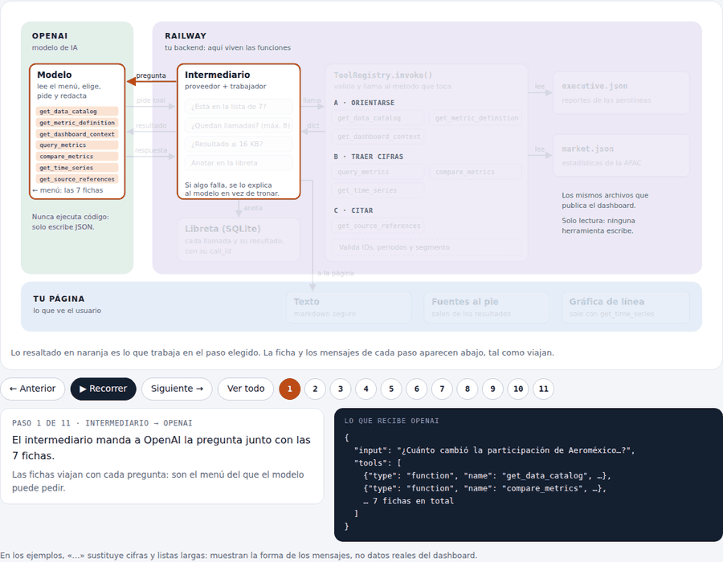

# Aerolíneas MX Tracker

Sistema reproducible de ingesta, consolidación, análisis y visualización de información pública de la **industria aérea mexicana**: **Grupo Aeroméxico S.A.B. de C.V.** (`AERO`, NYSE/BMV; CIK SEC `0001561861`), **Volaris** y **Viva**. "Industria" es la suma de las tres, ~99 % de los pasajeros de aerolíneas mexicanas (AFAC), con razones ponderadas por ASK y nunca promedios simples. El repositorio conserva el nombre `aeromexico-tracker` para no romper la URL de Pages.

El proyecto transforma fuentes regulatorias, operativas y de mercado en una lectura trimestral de negocio. Conserva los datos crudos con hash, separa cifras reportadas de derivadas, explicita faltantes y nunca rellena una ausencia como cero. Es un proyecto independiente de portafolio; **no es oficial ni constituye consejo de inversión**.

Las skills de búsqueda con puntos y el contrato del libro AMR se organizan en
[`automation/amr/`](automation/amr/README.md), dentro de este mismo repositorio.
Las corridas conservan sus skills instaladas y su configuración; los resultados
y las referencias privadas de Google Sheets permanecen fuera del público.

## Dashboard

La revisión actual reúne cuatro vistas: Lectura, Mercado, Economía y Noticias.
Mercado integra los indicadores de vuelos, el mapa existente, la participación y
la mezcla AFAC; el trimestre superior es común. El código vive en `web/`
(Vite + TypeScript) y se publica mediante el gate de GitHub Pages. La entrega
sigue el cierre descrito en [Periodos del dashboard](docs/periodos-dashboard.md);
la revisión local y un build no acreditan una nueva versión servida.

[Repositorio público en GitHub](https://github.com/salvamalfa/aeromexico-tracker)

**Dashboard público:** <https://salvamalfa.github.io/aeromexico-tracker/>

La autorización permanente de [`AGENTS.md`](AGENTS.md) permite a los agentes
publicar de principio a fin los cambios rutinarios que el dueño solicite,
incluidos PR, merge y despliegue en Pages, sin pedir permiso para cada paso.
Si el cambio afecta al dashboard público y usa datos y análisis ya aprobados,
se publica mediante el gate:

```
uv run python -m src.publish --record analysis_runs/drafts/<periodo>/<version>.json --out site/
uv run python -m src.publish.verify site/
```

Ver `src/publish/README.md` y `REPO_MAP.md` ("Publicación en GitHub Pages") para el flujo completo. El pipeline y dashboard estático usan Python **3.13** y no requieren secretos. El backend de chat es un extra opcional; solo su modo OpenAI lee `OPENAI_API_KEY` desde el entorno privado del servidor.

Para trabajar desde un clon local o con agentes de nube, consulta
[`AGENTS.md`](AGENTS.md) y la [guía de desarrollo desde GitHub](docs/cloud-development.md).
Cambios recientes: [`CHANGELOG.md`](CHANGELOG.md). Lo que sigue:
[`ROADMAP.md`](ROADMAP.md). Mapa del árbol: [`REPO_MAP.md`](REPO_MAP.md).



## Estado

- **Dashboard:** cuatro vistas, Lectura, Mercado, Economía y Noticias, con un
  trimestre global. Mercado integra los indicadores y el mapa existentes.
  Noticias filtra 26 fichas aprobadas por el trimestre global, según fecha de
  publicación; las demás siguen accesibles con fecha visible. El archivo
  mantiene cobertura parcial. El gate
  distingue el artefacto verificado de su integración y comprobación en Pages.
- **Corrección estadística:** el artefacto Linux reconstruye AFAC 2019–2025
  desde los originales oficiales, conserva las cifras de 2026 y extiende la
  serie mensual a septiembre. Recupera 77 comparativos BTS regulares con
  soporte físico. Gold, fuentes, gate y consumidor independiente están
  verificados; CI final y la comprobación servida se siguen por separado.
- **Analysis Agent:** cuatro lecturas de 3T26, para Aeroméxico, Viva, Volaris e
  Industria, con auditoría independiente y aprobación de sus versiones exactas.
  El perfil `quarterly_business_story_v1` verifica las fuentes y conserva
  resumen, desarrollo y citas. Volaris usa cuatro documentos originales SEC;
  sus cifras mostradas coinciden con la revisión anterior. Las tres lecturas
  3T26 sustituidas conservan su historia, expresamente no reproducida ni usada
  como fuente nueva. Los cuatro textos de 2T26 conservan sus bytes y su replay
  original completo. La publicación Linux verifica ocho análisis y doce JSON
  normales antes de entregar los commits del sitio. Se mantienen cifras no
  auditadas del emisor y cálculos propios identificados. Los cortes mensuales
  del mapa son independientes. [Estado y evidencia](docs/periodos-dashboard.md).
- **Actualización por producto:** el único coordinador de fuentes conserva el
  calendario activado y sus recibos privados. Los handoffs distinguen datos
  validados, análisis y dashboard por aerolínea, periodo y versión; conservan
  resultados independientes. La incorporación a gráficas y la publicación de
  una tesis tienen controles separados. Procedimiento y límites en el
  [contrato de ejecución](docs/calendario-ejecucion.md).
- **Chat:** fase 2 implementada; Stage 3 completó 30 casos/34 mensajes y la
  revisión privada recibió 16 correctos y 14 problemas. El dueño autorizó el
  ajuste final de R2 sin otra evaluación pagada. R2/Sol low y las capacidades
  de rutas, métricas financieras y evidencia están activos y verificados en
  Railway (ver [Chat analítico](#chat-analítico)).
- **Datos:** la base de Vuelos del 18 de octubre conserva el histórico e incorpora
  el BTS retenido de enero–julio de 2026, con operador y clase de servicio
  separados, y precedencia por celda entre observaciones y estimaciones retenidas.
  El mapa muestra solo vuelos, con su tipo y procedencia. No realiza nuevas
  capturas AeroDataBox ni ajustes de modelos. La opción adicional de estimaciones
  de EEUU permanece desactivada y requiere aprobación independiente.
  El [reporte BTS y sus límites](docs/etapas/bts-refresco-cobertura-20261017.md)
  distingue representación mixta de cobertura observada. AFAC se actualiza manualmente. Lo pendiente
  está en [`ROADMAP.md`](ROADMAP.md).
  La entrega trimestral incorpora AFAC septiembre y ANAC Brasil julio–septiembre;
  BTS y las frecuencias conservan julio. No atribuye cobertura uniforme al mapa
  ni activa su rediseño posterior con AFAC.

Conteos de tablas Gold y pruebas cambian con cada cambio; la cuenta vigente y
el comando para reproducirla están en [`REPO_MAP.md`](REPO_MAP.md), no aquí.

## Hallazgos principales

- Aeroméxico cerró `2026Q2` con ingreso total de **US$1,479 millones**, margen EBITDAR ajustado de **17.9%**, factor de ocupación de **84.9%** y spread unitario RASK−CASK de **0.43 centavos por ASK-km**.
- Entre `2026Q1` y `2026Q2`, el spread cayó **0.68 centavos**: precio aportó `+0.25`, combustible `−1.04` y el residual estructural `+0.11`; FX no pudo aislarse y no se estimó.
- En junio de 2026, la participación total AFAC fue **19.1%** para Aeroméxico frente a **26.2%** para Volaris.
- El forecast SARIMA publicado superó al naive estacional: sMAPE de test **2.50%** frente a **3.36%**, con bandas de 80% y 95% siempre visibles.
- Hay **23 anomalías** abiertas para investigación. No se presentan como errores confirmados.

## Ejecutar localmente

Requisitos: Git, `uv` y `just`.

```powershell
Copy-Item .env.example .env
# Completar SEC_USER_AGENT con un correo real y monitoreado.
just setup
just test
uv run python -m src.web_export --out web/public/data/v1 --allow-missing-analysis
cd web && npm ci && npm run dev
```

`npm run dev` imprime la URL local (`http://127.0.0.1:5173/` por defecto). No necesita internet para consultar las tablas ya construidas. Ver `web/README.md` para el detalle completo (build, preview, pruebas).

| Comando | Propósito |
|---|---|
| `just setup` | Instala el entorno bloqueado y Chromium. |
| `just ingest` | Ejecuta las ingestas registradas que usan red. |
| `just parse` | Reconstruye silver desde bronze inmutable. |
| `just transform` | Construye gold desde silver. |
| `just rebuild` | Reconstrucción completa offline desde bronze. |
| `just test` | Ejecuta la suite. |
| `just dashboard-validate` | Ejecuta los 15 controles de Etapa 10 y los 18 controles de regresión del dashboard. |

## Arquitectura

```text
fuentes públicas
      │
      ▼
data/bronze/     descargas inmutables + SHA-256; no se versionan
      │
      ▼
data/silver/     tablas fieles a cada fuente; no se versionan
      │
      ▼
data/gold/       43 Parquet consolidados y versionados
      │
      ├── data/warehouse.duckdb   vistas analíticas locales
      ├── src/analytics/          estudios y modelos precomputados
      └── src/dashboard/ + src/web_export/   payloads de contrato para web/
            │
            ▼
      web/ (Vite + TS)  ──build──▶  src.publish  ──▶  site/  ──▶  pages.yml (GitHub Pages)
```

Ver [`REPO_MAP.md`](REPO_MAP.md) para el detalle de qué genera cada módulo y
cómo se ensambla `web/` y se publica en `site/`.

Las tablas gold sí se versionan porque son los extractos públicos y compactos que consume el deploy. Bronze y silver siguen fuera de Git. Los hashes, URL y metadata de cada descarga viven en `data/bronze/_manifest.jsonl`; los cambios de contenido se registran en `_restatements.jsonl`.

## Datos y documentación

- [Catálogo completo y calendario de rondas mensuales/trimestrales](docs/catalogo-fuentes-calendario.md)
  (calendario aprobado, skills y coordinador candidato con pruebas en seco;
  sin nuevas ejecuciones automáticas ni publicación).
- [Continuidad sin capturas AeroDataBox recurrentes](docs/plan-salida-aerodatabox.md)
  (histórico conservado, mapa solo de vuelos y prueba AFAC/AICM).
- [Cierre de AeroDataBox, con capturas antes/después](docs/etapas/cierre-aerodatabox-20261014.md).

El Analysis Agent tiene una [skill del proyecto](.agents/skills/aeromexico-tracker-analysis/SKILL.md)
y [comandos de autoría](docs/analysis-agent/analista-v1.md). La revisión
auditada de 2T26 se conserva en `prototypes/etapa-17/audited_analysis.html`.

- [Diccionario de tablas y columnas](docs/diccionario-datos.md)
- [Diccionario de conceptos XBRL](docs/diccionario-conceptos-xbrl.md)
- [Hallazgos analíticos](docs/analytics/hallazgos.md)
- [Reportes de etapa vigentes](docs/etapas/) (histórico 0–18 en [`docs/archivo/etapas/`](https://github.com/salvamalfa/aeromexico-tracker/tree/747808228103f3d30afc582b42480ce4e5d05713/docs/archivo/etapas))
- [Plan original (histórico)](https://github.com/salvamalfa/aeromexico-tracker/blob/747808228103f3d30afc582b42480ce4e5d05713/docs/archivo/plan-original/README.md)

Fuentes principales: SEC EDGAR, BMV XBRL, AFAC, BTS T-100, Banxico, EIA, datos públicos de mercado, reportes de aerolíneas, grupos aeroportuarios y fuentes regulatorias abiertas. Las limitaciones y bloqueos de cada fuente están documentados en los reportes de etapa.

## Mercado

La [guía de periodos del dashboard](docs/periodos-dashboard.md) explica la entrada
en el último trimestre financiero verificable, los cortes independientes de
Economía/Vuelos/Mercado, las pruebas reales y los vacíos pendientes de datos.
La revisión local usa exclusivamente el trimestre global y reúne la lectura
en cuatro puntos de Industria, Aeroméxico, Viva y Volaris, sin selectores propios.

Mercado reúne participación, tamaño y cambios interanuales del universo AFAC.
El trimestre global controla gráfica, tarjetas y tabla; las tres aerolíneas se
muestran siempre y sólo se filtra el segmento. La revisión local incorpora el
resumen oficial AFAC hasta septiembre de 2026, con Q3 completo. Cuando un trimestre
sea parcial, compara exclusivamente los mismos meses del año anterior y muestra
su cobertura en el icono de información amarillo; nunca sustituye otro trimestre.
Los cambios positivos llevan signo y verde; los negativos, signo y rojo.
La fuente y el último mes de la gráfica se consultan en el icono superior.
Los datos aeroportuarios permanecen en su exportación.
El [plan coordinado](docs/publicacion-mercado-noticias.md) documenta el gate y
el orden de integración de Vuelos, Mercado y Noticias.
La [auditoría Gold](docs/gold-exposure.md) distingue exposición, contexto y linaje.

## Actualización

`.github/workflows/refresh.yml` se ejecuta trimestralmente y también de forma manual. Solo monitorea frescura y valida/confirma (commit) el gold ya reconstruido en el runner — no publica el sitio: eso es `.github/workflows/pages.yml`, sobre `site/`. Corre la suite completa y `src.dashboard.validate_stage8` (definición de terminado de Stage 8, sobre el gold público versionado); si algo falla abre un issue y no hace commit. También revisa la fecha de AFAC y abre un recordatorio cuando la fuente manual rebasa 62 días.

Por la decisión explícita de **no versionar bronze**, una reconstrucción con nuevas descargas sigue ejecutándose localmente, donde existen los crudos. El workflow remoto valida y confirma (commit) el gold ya reconstruido; no finge poder recrear fuentes manuales ausentes ni publica el sitio.

## Noticias y estrategia

El archivo presenta las 26 fichas aprobadas del índice y responde al trimestre
global usando `published_at`; no infiere periodo desde la fecha del hecho.
Las fichas fuera del trimestre permanecen en un desplegable identificado con
su mes y fecha. La cobertura parcial se muestra junto al archivo. Se puede
buscar desde el chat con navegación citada. Las once candidatas del
[corte de investigación](docs/etapas/noticias-candidato-20261015.md) siguen
pendientes de revisión y no amplían la evidencia del chat.
La [auditoría Gold](docs/gold-exposure.md) conserva los datos y sus dependencias.
La combinación de Noticias y las herramientas de actualización usa tres pares
técnicos de 2T26 con auditoría independiente y consentimiento específico del dueño.
El gate revalida las cuatro lecturas antes de firmar el sitio; Aeroméxico conserva
su registro histórico. La publicación no amplía las noticias candidatas ni activa
calendarios, datos de Airline Monthly M11 o trabajo de fuentes de otros hilos.
GDELT conserva primera observación y captura sin inventar publicación mensual.

## Chat analítico

El chat responde preguntas sobre el snapshot público con una capa semántica
versionada; no abre el warehouse ni convierte ausencias en cero. El MVP sigue
activo en Railway con `gpt-6.1-sol`, acceso con contraseña, topes diarios de
US$5 (por usuario y global) y hasta 16 llamadas de herramienta por pregunta.
La fase 2 está implementada y activa; el despliegue final está verificado.
Stage 3 completó 30 casos/34 mensajes con costo estimado registrado de
US$2.626185. La revisión del dueño recibió 16 calificaciones correctas y 14
problemas; 13 notas mencionan el periodo, pero 12 de esos casos se ejecutaron
sin contexto del dashboard. La interfaz ya envía automáticamente la selección;
esta campaña no demuestra que el chat ignore el selector real.

El dueño autorizó corregir R2 y omitir otra evaluación pagada. El ajuste prioriza
el periodo seleccionado y la recuperación de evidencia en inglés cuando la
pregunta está en español. Railway confirmó `SUCCESS` sobre el commit `30a931d`;
health 200 confirmó R2, Sol low/medium, worker y admisión activos, y capacidades
de rutas, métricas financieras y evidencia habilitadas. El snapshot público no
cambió. El código conserva R1 y flags apagados como defaults; producción los
selecciona explícitamente. No hubo otra evaluación pagada ni se acreditó el
gate original de 70 casos/safety. Ver [cierre operativo](docs/etapas/chat-fase2-cierre-operativo-20261012.md).

- Operación, instalación y límites: [documentación del chat](docs/chat/README.md)
  y [traspaso operativo](https://github.com/salvamalfa/aeromexico-tracker/blob/7ff22ed473d748808dde808d3dd2c63f9916b269/docs/chat/traspaso-activacion-mvp-20261006.md).
- Implementación y cierre técnico: la [fase 2](https://github.com/salvamalfa/aeromexico-tracker/blob/7ff22ed473d748808dde808d3dd2c63f9916b269/docs/chat/fase-2-agente-analitico.md)
  y el [resumen para decisión del dueño](docs/chat/fase-2-decision-dueno.md).

El perfil `chat-runtime` instala solo las dependencias del backend. El gasto se
controla con un tope diario en dólares configurable en Railway (US$1 si no se
configura), con el cupo de tokens solo como freno; el registro contable privado
del consumo se conserva.

### Cómo funciona el chat

Una pregunta pasa por 7 piezas del backend en 11 pasos:



El diagrama muestra las 7 herramientas base del agente en el escenario
«comparar dos periodos». Producción con R2 tiene 13 herramientas: las 7 base
y 2 adicionales por cada capacidad de rutas, métricas financieras y evidencia:



Las versiones interactivas, con tres escenarios y el JSON de cada paso, están en
[`docs/arquitectura/anatomia-chat.html`](docs/arquitectura/anatomia-chat.html) y
[`docs/arquitectura/anatomia-herramientas.html`](docs/arquitectura/anatomia-herramientas.html).
GitHub las muestra como código: descárgalas y ábrelas en un navegador.
