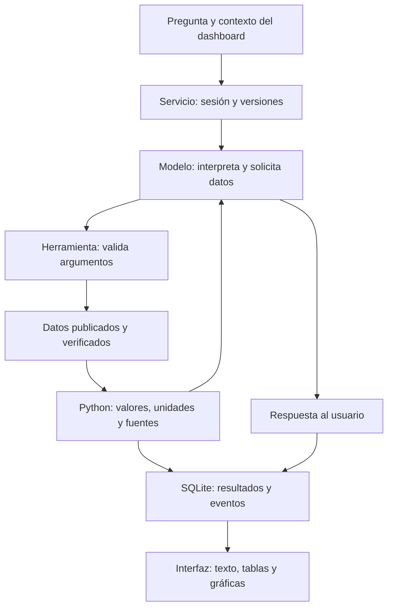

# Cómo funciona el chat de Airlines Tracker

El modelo interpreta la pregunta y elige herramientas de consulta. Python valida
sus argumentos y calcula sobre los datos publicados. El modelo recibe esos
resultados para redactar; no obtiene acceso directo al almacén privado.

El [adaptador OpenAI](../../src/conversational_analytics/providers/openai.py)
usa el cliente oficial `openai==3.13.0` y Agents API con
`environment.type="none"`. Las funciones se ejecutan en el backend del proyecto.

## Entradas, modelo, herramientas y respuesta

| Parte | Qué recibe y qué hace |
|---|---|
| Entrada | Pregunta y contexto de vista, tarjeta, entidad, filtros y periodo. El contexto se valida y puede cambiar entre mensajes. |
| Modelo | Instrucciones versionadas, catálogo de funciones y resultados autorizados. Solicita consultas y redacta la respuesta. |
| Herramientas | Argumentos estructurados. Comprueban versiones, unidades, dimensiones y cobertura antes de leer o calcular. |
| Datos | JSON de `site/data/v1/` comprobados contra el manifiesto y los contratos; extractos de evidencia aprobados cuando esa capacidad está habilitada. |
| Respuesta | Texto del modelo y resultados persistidos. Las referencias, tablas y gráficas se vinculan a los datos devueltos por las herramientas. |

### Funciones disponibles

El [registro de herramientas](../../src/conversational_analytics/tools/registry.py)
define siete funciones base: `get_data_catalog`, `get_metric_definition`,
`query_metrics`, `compare_metrics`, `get_time_series`, `get_source_references`
y `get_dashboard_context`.

R2 puede añadir `query_routes`, `find_shared_routes`, `query_business_metrics`,
`get_business_metric_definition`, `search_reports` y `search_news`. Cada capacidad
requiere configuración explícita y un prompt compatible aprobado.
`query_official_routes` tiene una activación separada, fijada a la versión del
mapa oficial. La [referencia del backend](../../src/conversational_analytics/README.md)
documenta estos controles.

La [búsqueda de evidencia](../../src/conversational_analytics/evidence_index.py)
consulta extractos y metadatos previamente revisados mediante búsqueda
determinista. No incorpora documentos nuevos durante la pregunta ni usa una
base vectorial. El agente no dispone de shell ni navegación web.

## Semántica y datos confiables

El catálogo distingue métricas, entidades y periodos. El texto de la pregunta,
el contexto del dashboard y las fuentes se tratan como datos, separados de las
instrucciones confiables. Un filtro no autoriza otra fuente ni amplía cobertura.
Los faltantes mantienen su significado y las estimaciones no se convierten en
observaciones.

[`Snapshot`](../../src/conversational_analytics/data/snapshot.py) comprueba
inventario, tamaño, hashes y contratos de los datos publicados. Cada conversación
conserva `data_version` y `semantic_version`; un cambio exige otra conversación
antes de consultar. El proveedor `mock` usa el mismo registro determinista,
sin generar una respuesta con un modelo.

## Sesiones y turnos

El primer mensaje crea una sesión con `sessions.create(..., input=..., stream=True)`.
Los siguientes abren `sessions.events.stream(session_id)` antes de enviar
`agent.session.input.message`. SQLite conserva los identificadores privados,
el historial y cada resultado de herramienta mediante `(turn_id, call_id)`.
El navegador recibe eventos del servicio, no identificadores del proveedor.

Sólo `agent.session.turn.completed` confirma éxito;
`agent.session.turn.failed` y `agent.session.turn.cancelled` conservan sus
estados terminales, y `agent.session.idle` no completa un turno.
El adaptador desactiva los reintentos automáticos del SDK y recupera estado ante
una desconexión, sin reenviar una entrada ambigua. Cancelar utiliza
`agent.session.input.cancel`; borrar una conversación solicita también eliminar
la sesión remota. La [referencia HTTP](../../src/conversational_analytics/README.md#contrato-http)
explica recuperación de eventos, límites y autenticación.

## Verificación y límites actuales

[`tests/test_chat_openai.py`](../../tests/test_chat_openai.py) verifica eventos,
herramientas, recuperación, cancelación y borrado con clientes simulados. No
comprueba acceso real de una cuenta, disponibilidad del modelo ni calidad de
sus respuestas. La [guía del chat](../chat/README.md#estado-de-entrega) separa la
verificación operativa documentada de la evaluación de respuestas.

Las dependencias están fijadas en `pyproject.toml` y `uv.lock`. La configuración
y el arranque tienen una única referencia en
[el backend](../../src/conversational_analytics/README.md#proveedores-y-configuración)
y [operación local](../chat/operations.md). Las pruebas ordinarias no necesitan
credenciales ni llamadas pagadas.

## Recorridos visuales

Los recorridos existentes explican el flujo base en un simulador. Muestran
siete herramientas y límites ilustrativos; no acreditan la configuración
actual ni una ejecución de producción. Cada uno tiene alternativa estática:

- Chat: [GIF explicativo](../assets/chat/anatomia-chat-recorrido.gif),
  [resumen estático](../assets/chat/anatomia-chat-resumen.png) y
  [HTML para abrir en el navegador](anatomia-chat.html).
- Herramientas: [GIF explicativo](../assets/chat/anatomia-herramientas-recorrido.gif),
  [resumen estático](../assets/chat/anatomia-herramientas-resumen.png) y
  [HTML](anatomia-herramientas.html).

Contrato del proveedor consultado el 4 de octubre de 2026:
[Agents API](https://developers.openai.com/api/docs/guides/agents-api/overview),
[sesiones](https://developers.openai.com/api/docs/guides/agents-api/sessions),
[eventos](https://developers.openai.com/api/docs/guides/agents-api/sessions/events)
y [funciones](https://developers.openai.com/api/docs/guides/agents-api/tools/functions).
