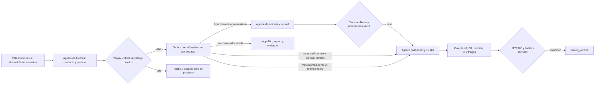

# Calendario único y actualización independiente por producto

## Resumen

El calendario privado quedó activado el **29/oct/2026**, con un único disparo
flexible para la mañana del **30/oct**, zona `America/Mexico_City`. El acuse
de creación y el ID vinculado están en su estado privado recuperable. Una tarea
habilitada no demuestra ejecución: el recibo de cada fuente acredita ese tramo.
La autorización del 30/oct amplía el alcance a los datos y las tesis validados
de Aeroméxico, Viva y Volaris. Industria y otros productos editoriales conservan
sus límites. El calendario, el análisis y la publicación tienen estados distintos.
Las reglas y las dependencias de fuentes siguen en el
[catálogo canónico](catalogo-fuentes-calendario.md).

El [registro operativo](../scripts/source_update_coordinator.py) añade solo la
persistencia que faltaba entre turnos. Reutiliza `calendar`, `plan`, `retry` y
el bloqueo exclusivo del recolector. No adquiere fuentes, envía mensajes,
crea automatizaciones ni publica. El agente coordinador invoca realmente los
subagentes con el [mapa de despacho](../scripts/source_update_dispatch.py);
los candidatos y `global_readiness` conservan
sus controles y su límite `ready_for_automatic_execution=false`.

## Qué cambia para ti

El próximo mensual conocido es **17 de noviembre de 2026**, para `2026M10`.
El siguiente es **15 de diciembre**, para `2026M11`. Ambos se calculan con
los [festivos bancarios verificados](../config/source_update_holidays.json).
La mañana se representa a las 08:00 en `America/Mexico_City`, con
`timing_mode=flexible_schedule`: no es una hora de publicación de fuente.
No se genera una regla diaria o semanal ni se extrapola 2027.

Viva 3T26 está incorporado y verificado en [PR177](https://github.com/salvamalfa/aeromexico-tracker/pull/177),
con publicación documental del 28/oct. Los siete candidatos trimestrales y sus
32 salidas se reprodujeron al corte congelado del 29/oct en el expediente privado.
Eso acredita candidatos, no publicación de sus datos o tesis. El último financiero
confirmado del 28/oct fijó el evento **30/oct** con dos hábiles posteriores.
No se cambia ese disparo ni se adelanta para probar los nuevos tramos.
El siguiente evento mensual sigue siendo 17/nov dentro del mismo calendario.

Aerocivil queda **utilizable con supuestos operacionales documentados** tras
verificar sus datos reales; la respuesta oficial ya no bloquea por sí sola.
No se cambia el producto requerido, los códigos originales ni la confirmación
oficial pendiente. Datos faltantes o disponibilidad no acreditada siguen
bloqueando el resultado correspondiente. Si la respuesta contradice los
supuestos, se versionan los cálculos afectados. No se repite la consulta enviada.

El enlace de disponibilidad Aerocivil reutiliza el verificador nativo de máximo
mes y lo incorpora a `readiness`, sin convertirlo en trimestre completo. La
receta declara `availability` con `source_scope=aerocivil_retained_maximum_month_v1`,
`workspace` de la colección aislada y `collection_id` real. Se cotejan el mes
nativo, recibo, consulta, originales, hashes y salidas; se conserva la regla de
captura en el mismo día local de la ronda. La consulta retenida del 21/oct
permite reproducir ese corte histórico y **no** acredita disponibilidad al 29/oct.
Una ronda actual necesita una observación actual autorizada, sin renovar la fecha
ni el hash del original retenido.

Noticias es una tarea mensual del mismo plan, con búsqueda nativa y lectura
de fuentes. RSS/GDELT permanecen opcionales. El registro selecciona por defecto
el núcleo requerido de la política vigente y Noticias. Enumera los demás
productos sin programarlos. Si se usa contexto adicional, la receta y el
control global existentes deben validar ese producto y sus dependencias.

| Evento del calendario único | Periodo | Estado de la fecha |
|---|---|---|
| Finanzas, macro/mercado y alcance colombiano trimestral | 3T26 | 30/oct activado; ejecución se acredita con recibos |
| Datos mensuales y Noticias, juntos | Octubre 2026 | 17/nov calculado; reprogramar el mismo ID tras reconciliar el evento anterior |
| Datos mensuales y Noticias, juntos | Noviembre 2026 | 15/dic calculado; conservar el mismo ID |

Una publicación es un hecho de la fuente, distinto del evento de ejecución.
Un financiero primario confirmado permite avisar y preparar su paquete
independiente con el alcance autorizado. Las demás novedades se descubren en
la ronda consolidada; no se inventa un día 13 ni se instala un sondeo por fuente.
Los periodos propios y rezagos de AFAC/BTS se conservan.

## Apéndice técnico

### Handoff por fuente, producto y periodo

El [outbox por producto](../scripts/source_update_handoffs.py) conecta los
resultados con las skills de [análisis](../.agents/skills/aeromexico-tracker-analysis/SKILL.md)
y [dashboard](../.agents/skills/airline-update-dashboard/SKILL.md). El coordinador
invoca sus envelopes mediante herramientas nativas del host. El CLI conserva
intención, respuesta y recibo; no puede ejecutar herramientas del host ni
atribuirse una publicación. Los recibos separan recuperación, ejecución
programada, build validado y datos efectivamente servidos.

La unidad es el producto validado, no el cierre de la ronda. El outbox vive en
otro directorio privado bajo `tmp/source-updates/`, ligado al calendario canónico
por referencia física y SHA. Una copia inmutable de los bytes observados vive
en `evidence/calendar-<sha>.json` sólo como evidencia; no se opera como ledger.
El progreso legítimo del calendario no invalida esa prueba. El outbox no sustituye
el ledger canónico ni cambia horarios. Una
observación declara su tarea, autorización, motivo, corte original y un `item`
de readiness. `verify_source` coteja el calendario y ejecuta el verificador
dedicado real del producto, con disponibilidad propia o edición cerrada aceptada.
No recibe booleanos de aprobación como sustituto del replay.

Después de cada fuente completada, el coordinador registra `observe` y procesa
`ready_jobs` antes de esperar otras fuentes. Los financieros de Aeroméxico,
Viva y Volaris generan análisis de su entidad y un trabajo independiente de
datos para sus gráficas existentes. El segundo no espera una tesis nueva.
Banxico, combustible y cotizaciones no alimentan actualmente las gráficas
servidas: quedan como `no_public_impact`, con hashes de los consumidores
auditados, sin inventar un panel ni una actualización visible. Una revisión
cruzada material necesita una decisión analítica explícita con fuentes y motivo.
Los productos sin ruta ejecutable quedan fuera del handoff hasta implementarla;
esa limitación no acredita que el flujo completo esté terminado.

`data_version` identifica las filas de negocio de las tablas fact Gold candidatas.
Conserva campos de significado y precisión numérica, excluye IDs de linaje y
metadatos de captura. Cambiar sólo descarga, ruta o fecha no genera otra tesis.
Una revisión numérica, de unidad, cobertura o definición sí cambia la versión.
Una reversión posterior también se registra como una llegada nueva. Se conserva
la versión previa y su motivo; nunca se sobreescribe el histórico para deduplicar.

1. Registrar una acción privada `observe`, con `operation_id` estable y `at`
   real, mediante `python -m scripts.source_update_handoffs --workspace
   tmp/source-updates/<outbox> --record <acción.json>`.
2. Para cada trabajo listo, registrar `claim` con `job_id` y dueño
   `owner_lease_id=local_lease:<token>`. El estado fija el envelope exacto antes
   del envío. Invocar `attempt.native_call` con la herramienta nativa del host.
3. Retener la respuesta de herramienta en un JSON físico con `native_task_name`
   real y registrar `acknowledge` con `native_response={path,sha256}`. Los IDs
   nativos desconocidos siguen nulos. Sin respuesta, consultar el trabajo
   existente: una intención incierta no vuelve a `planned` ni se reenvía.
4. Retener el recibo del trabajador y registrar `finish` con `receipt={path,sha256}`.
   El recibo liga `job_id`, `data_version`, `entity`, `period` y estado. Un fallo
   de Viva no impide que un trabajo de Volaris continúe. Un resultado superado
   por datos más nuevos se conserva como `superseded` y no dispara publicación.
5. `analysis_approved` necesita un registro físico exacto y pasa el lifecycle
   canónico: replay, citas, auditoría y aprobación vigente. Su cápsula contiene
   `source_binding` con producto, periodo, retención, corte y salidas/hash del
   candidato. Otra tesis del mismo trimestre no acredita este consumo.
   Sólo entonces se encola su trabajo editorial de dashboard. El trabajo de
   datos validado se había encolado por separado, con `release_kind=data`;
   ambos se serializan al escribir el sitio. El editorial usa `release_kind=editorial`.
   Un resultado `no_material_analysis_change` mantiene la aprobación anterior
   sólo tras la prueba física de equivalencia de Aeroméxico; no encola una
   nueva publicación editorial. El outbox conserva ese recibo como `no_change`.
6. `site_built_verified` pasa el gate y verificador del sitio; aún no es despliegue.
   Tras PR, revisión, CI, merge y Pages, registrar `served` con las rutas afectadas.
   El comando realiza GET a la URL canónica y exige HTTP200 y los mismos hashes
   del manifiesto y payloads/páginas elegidos. Sólo entonces conserva
   `served_verified`. Si la red falla, conservar el build y reconciliar el despliegue.
   Un build `completed` conserva la exclusión del escritor del dashboard hasta
   esa QA: otro trabajo no puede reemplazar `site/` ni su manifiesto mientras
   queda pendiente verificarlo. Un fallo HTTP o de hash mantiene el bloqueo.
   Si entretanto llega otra revisión de la misma fuente, la QA del build ya
   completado acredita sus propios bytes y registra `is_current_source=false`.
   No lo presenta como la versión nueva ni cambia la cabeza de datos. Tras
   esa comprobación puede continuar el trabajo pendiente de la nueva versión.
   `no_visual_change` también exige replay: para Viva/Volaris se reconstruye
   la proyección de la cápsula y se compara con el sitio de referencia; para
   Aeroméxico se ejecuta la prueba de equivalencia aprobada. El recibo conserva
   `equivalence_proof={path,sha256}` y el verificador lo reproduce. Un texto que
   diga «sin cambios» no sustituye esa comprobación ni acredita un despliegue.

La frontera sigue siendo candidato aislado antes del gate. Ni `observe` ni
`analysis_approved` copian tablas a Gold activo. La skill del dashboard incorpora
únicamente los datos aprobados que utiliza, mantiene las versiones publicadas
ajenas y genera sus gráficas antes de validar el artefacto. El gate conserva
las comprobaciones de privacidad y aprobación. El outbox no concede
aprobaciones ni activa evidencia candidata de Vuelos.

Los registros `mode=scheduled_result` requieren tarea completada y candidato
dentro del worker reconciliado. Si el nuevo tramo continúa resultados
anteriores, usar `mode=recovery_from_validated_result`: conserva ese origen,
el corte de la evidencia y la autorización actual; no se presenta como una
ejecución automática anterior. Aplica también al 30/oct si el código de los
nuevos tramos termina después de su actualización de fuentes.

Si una corrección del código invalida una aprobación técnica **todavía no
publicada**, la operación `refresh_analysis_approval` permite conservar el
trabajo editorial y revisar su nueva identidad técnica. Es una recuperación
acotada: requiere el mismo texto completo, `content_hash`, paquete, cálculos,
producto, periodo y `data_version`; debe cambiar de verdad el código o la skill
ligados al registro. No permite cambios de prosa o datos, revocaciones previas,
análisis superados ni descendientes de dashboard en envío incierto, ejecutándose,
construidos o servidos. Un worker activo debe reconciliarse antes de esta operación.

El agente conserva el mismo worker y registra su nueva versión mediante el
lifecycle normal: importación, auditoría y aprobación vigente. Después presenta
al outbox un JSON con `action=refresh_analysis_approval`, `operation_id`, `at`,
`job_id`, `owner_lease_id` original, `previous_result={path,sha256}` exacto,
`receipt={path,sha256}` del nuevo `analysis_approved`,
`review_report={path,sha256}` y `reason` concreto. El informe físico se compara
con el audit registrado y su hash canónico; su SHA de archivo es otra identidad.
El CLI no fabrica una aprobación. Conserva ambos recibos en `receipt_history`
y añade referencias, motivo y aprobaciones en `technical_review_history`.
No crea trabajos o envíos, ni cambia cabezas, fuentes o versiones de datos.

Si un dashboard dependiente ya estaba trabajando, retener su recibo real de
bloqueo y continuar ese mismo worker con `continue_existing_worker` y un
follow-up nativo después de registrar la revisión. No reescribir su intención
original ni volver a despacharlo. Repetir la misma operación y argumentos
es idempotente; reutilizar su ID con otros argumentos se rechaza.

`mode=validated_publication_arrival` permite procesar un financiero individual
confirmado antes de la fecha consolidada y sin que existan los otros reportes.
No exige que el periodo ya esté en las tareas preplanificadas. Sí exige el
calendario único vinculado, autorización vigente, replay completo propio y
`publication_evidence={path,sha256}` del original realmente usado por las
filas financieras. Es un handoff de una llegada conocida, no otro monitor.
La incorporación debe conservar la publicación y el corte comprobados; el
evento consolidado y sus disparos existentes permanecen intactos.

Aerocivil tiene un handoff de dashboard propio: trabajo `2026Q3` y dato nativo
`source_period=2026M07`. El adaptador sólo valida ese mes con su comprobador
dedicado y la política operacional provisional; no convierte el código S/I en
una leyenda oficial ni acredita cobertura trimestral. Una captura idéntica no
duplica el trabajo. Una revisión real conserva una versión nueva e historial.
El outbox encola `release_kind=movements`, sin análisis financiero y con
`dependency=null`; el sitio conserva las tesis y usa su gate de movimientos.
El binding que ese gate coteja identifica el mes nativo, retención/colección,
corte y salidas exactos. Si cambió el productor, hace falta certificación nueva
offline en otro workspace; el fallo de fingerprint nunca se ignora.



### Un estado privado y un coordinador

La ruta canónica es la que consta en `state.workspace`; el identificador es
`airlines-tracker-source-calendar`. El estado vive bajo
`tmp/source-updates/<coordinador>/`, ignorado por Git, fuera de datos públicos.
No copiarlo al PR ni crear otro ledger para el mismo calendario. Una copia en
otra ruta se rechaza. El despliegue futuro debe conservar este mismo entorno
y ruta o restaurar el último estado privado verificado antes de operar. Si no
se puede recuperar, bloquear; no interpretar su ausencia como primera ejecución.

`state.json` comienza con `activation_authorized=false`, `automation_id=null`
y `publication_authorized=false`. Conserva zona, fechas mensuales y trimestral
conocidas o nulas, eventos por fecha y miembros, y claves
`cadence:period:product`. Cada tarea tiene `planned`, `running`, `completed`,
`retry_pending` o `blocked_for_decision`; recibos, SHA-256, mensajes y turnos
permanecen separados. `completed` describe el cierre operativo de un despacho;
`certification` sigue nulo. Un nuevo periodo nunca hereda una certificación.

La escritura usa el `writer` existente y sustitución atómica del JSON tras
`fsync`; en POSIX también sincroniza el directorio. En Windows la garantía
local cubre caída de proceso; la recuperación de host exige el último respaldo
privado verificado. Una intención guarda el dueño antes del envío externo.
Los bloqueos persistentes `active_tasks` y `active_task` conservan las
intenciones y el dueño entre comandos, incluso si el proceso desaparece.
Varios workers aislados del mismo dueño pueden preparar candidatos en paralelo;
otro dueño o un escritor serial no entra hasta reconciliar los anteriores.
Las rutas de candidatos anteriores siguen reservadas. La consolidación del
registro común tiene un solo escritor; nunca se comparte Bronze entre workers.

`record_conditional_authorization` conserva la decisión recibida y sus
condiciones sin poner `activation_authorized=true` ni asignar una automatización.
Las condiciones registradas como verificadas después son afirmaciones del
operador con referencias reales, no pruebas fabricadas por rellenar booleanos.

### Fuente, skill y subagente responsable

El mapa ejecutable enumera los **43 productos del catálogo y la tarea editorial**.
Cada producto declara fuente, skill exacta/SHA, cadencia de publicación del
proveedor, disparador, fecha oficial conocida o nula, procedimiento/limitación,
agente lógico y destinos. `handoff_eligible` significa que puede asignarse a una
skill; no acredita que exista un adaptador universal o datos completos.

| Familia y fuentes/productos | Skill exacta |
|---|---|
| Empresas: IR Aeroméxico/Volaris/Viva, SEC/BMV y comparables | [airline-update-corporate](../.agents/skills/airline-update-corporate/SKILL.md) |
| Tráfico: AFAC por empresa/aeropuerto/país/marginal y BTS México–EEUU | [airline-update-traffic](../.agents/skills/airline-update-traffic/SKILL.md) |
| Aeropuertos: GAP, ASUR, OMA, AICM y AIFA | [airline-update-airports](../.agents/skills/airline-update-airports/SKILL.md) |
| Macro/mercado: Banxico, H.10 separado, EIA y cotizaciones | [airline-update-macro-market](../.agents/skills/airline-update-macro-market/SKILL.md) |
| Rutas: Aerocivil, ANAC, CAA, Aena y documentos de rutas | [airline-update-routes](../.agents/skills/airline-update-routes/SKILL.md) |
| Contexto: OurAirports, FAA IASA y diccionario | [airline-update-context](../.agents/skills/airline-update-context/SKILL.md) |
| Noticias: búsqueda/lectura nativa y descubrimiento RSS/GDELT opcional | [airline-update-news](../.agents/skills/airline-update-news/SKILL.md) |
| Internos: perfiles, fuentes curadas y cálculos derivados existentes | [airline-update-internal](../.agents/skills/airline-update-internal/SKILL.md) |

El nombre lógico se liga a `cadence:period:product` y al evento. El ID real del
subagente queda nulo hasta recibirlo de la herramienta. El
[coordinador](../.agents/skills/airline-update-coordinator/SKILL.md) registra la
intención y luego invoca `jobs[].native_call` con herramientas nativas reales.
El CLI de despacho solo materializa esos argumentos; no puede fingir un envío.
Si el host no tiene capacidad nativa, el coordinador devuelve un bloqueo.

Cada worker lee y verifica la skill, ejecuta plan/receta y su adquisición o
retención autorizada, conserva evidencia/originales en `evidence/` y
`data/bronze/`, procesa `data/silver/`, construye sus salidas y linaje en
`data/gold/`, y guarda recibos en `receipts/`. Esas son rutas de candidato:
su existencia no demuestra que las capas se hayan producido. El adaptador
dedicado determina los pasos reales. Noticias conserva evidencia editorial y
su candidato propio; internos/derivados pueden reutilizar padres sin Bronze nuevo.

Si falla la vía programática, el agente usa navegación oficial normal mediante
el navegador cloud/local autorizado disponible, o devuelve el handoff al
coordinador si no dispone de él. Los originales se transfieren por Library y
se cotejan en el consumidor. No se amplían permisos ni se eluden accesos,
TLS, CAPTCHA o autenticación; SEC, Aena y reconstrucciones mantienen sus contratos.
El ensayo en seco no demuestra ese fallback ni disponibilidad de una fuente.

El coordinador reúne recibos y resultados independientes y ejecuta los
comprobadores existentes de conteos, periodo, cobertura, revisiones,
Bronze/Silver/Gold y linaje, además de dependencias/readiness global. No vuelve
a transformar todo con un rebuild universal ni publica automáticamente.
El reparto respeta las ranuras reales del host y las dependencias de los
productos derivados. La consolidación implementada es de recibos y candidatos
verificados; no hay una copia automática de todos los Gold candidatos al
dataset activo. Su incorporación y publicación conservan los controles existentes.

Preparar una sola vez con un JSON privado que declare `as_of`, `start`,
`months`, `quarter` y `releases`. Los releases tienen la forma del CLI
`calendar`; sus confirmaciones son revisiones explícitas de documentos reales,
no una inferencia del nombre de archivo. Conservar la referencia de revisión
en ese JSON. La preparación no vuelve a consultar las fuentes.
El estado retiene esa solicitud íntegra y sus releases. El monitor puede
aportar solo Viva: los registros nuevos se añaden por contenido, sin sustituir
ni renovar los días, hashes o referencias anteriores.

```bash
python -m scripts.source_update_coordinator --workspace tmp/source-updates/calendar-coordinator --prepare <solicitud-privada.json> --now 2026-10-29T04:00:00Z
python -m scripts.source_update_coordinator --workspace tmp/source-updates/calendar-coordinator
python -m scripts.source_update_dispatch --source-map
python -m scripts.source_update_dispatch --state <estado-canónico-absoluto.json> --event-id <evento-exacto> --as-of <corte-real-con-zona> --dry-run
```

El primer comando escribe el plan privado; repetir la misma solicitud conserva
los bytes. Otra solicitud no puede sustituirlo ni reiniciar contadores. El
segundo solo lee y emite `next_trigger.payload`. El payload contiene título,
prompt, `schedule` VEVENT sin RRULE, zona y modo flexible. **Mostrarlo no lo
crea ni autoriza ejecutarlo.** Si está vencido o hay un escritor sin resolver,
el payload es nulo y exige reconciliación. No se mueve a mañana por defecto.

### Activación realizada y recuperación de su creación

La capacidad nativa conocida crea tareas habilitadas y no admite crearlas
apagadas. La creación del 29/oct ya está confirmada y vinculada; no ejecutar
`create` otra vez. Los siguientes pasos documentan el historial y la recuperación
de una creación incierta; su aplicación inicial ya se completó:

1. Comprobar el estado canónico y las tareas nativas existentes. Conservar la
   referencia exacta de la autorización condicional. Cotejar los recibos de Viva y sus fechas,
   los datos requeridos con replay/global de la cadencia real y la capacidad nativa
   de despacho. Aerocivil requiere su prueba operacional positiva, no respuesta
   oficial; las fuentes faltantes no pasan por tener supuestos. Registrar
   `activation_intent` con referencias a esos resultados antes de
   llamar a la herramienta nativa.
2. Crear una tarea con el payload puntual revisado. No crear otro monitor de
   Viva. Un resultado incierto deja `automation_creation.outcome=uncertain`.
3. Consultar la tarea nativa por intención, título, prompt y momento. Cuando
   se conoce el ID, registrar `bind_authorized_automation` con ese mismo
   `intent_id` y la referencia del resultado. Nunca repetir `create` por
   ausencia de respuesta. `activation_not_created` requiere prueba positiva
   de que la creación no ocurrió; una búsqueda sin resultados no basta.
4. Tras cada resultado reconciliado, actualizar **el mismo `automation_id`**
   al próximo payload. Registrar la intención de actualización en el
   expediente; ante respuesta incierta, leer su horario antes de repetir.
   Una actualización al mismo ID no justifica crear un reemplazo.

El registro acepta afirmaciones del operador autorizado; no demuestra por sí
solo que el usuario haya dado permiso ni que el proveedor haya completado una
acción. Las referencias a conversaciones y recibos son evidencia retenida,
no aprobaciones fabricadas. La publicación nunca se habilita en este registro.

### Contrato de acciones y recibos

Cada acción se pasa en un JSON privado con `--record <acción.json>`, un
`operation_id` estable y `at` con zona. Repetir el mismo ID y argumentos es una
lectura idempotente; cambiar argumentos con ese ID falla. `at` no puede ser
posterior al corte `--now`. Campos adicionales por acción:

| Acción | Campos y efecto |
|---|---|
| `record_conditional_authorization` | `authorization_reference`, `operational_policy_id`; conserva la decisión y condiciones; no activa ni crea una tarea. |
| `refresh_reports` | `releases`; confirma fechas antes de activar o despachar, sin certificar cifras. |
| `activation_intent` | `activation_authorized=true`, referencia de autorización y de condiciones verificadas; guarda intención incierta, sin llamar a la herramienta. Con autorización condicional exige booleanos exactos de Viva, datos requeridos, despacho nativo y coordinador único. |
| `bind_authorized_automation` | `intent_id`, `automation_id`, `reconciliation_reference`; liga el resultado real de aquella creación. |
| `activation_not_created` | `intent_id`, `confirmed_not_created=true`, `reconciliation_reference`; solo tras probar que no se creó. |
| `dispatch_intent` | `automation_id`, `task_key`, `event_id` y dueño; exige fecha y miembros exactos y persiste `running` antes del envío. Para paralelo: `execution_mode=isolated_skill_worker` y `worker_workspace` disjunto. |
| `acknowledge` | Tarea/dueño y IDs reales de mensaje/turno, o `native_task_name` con `native_response_sha256` si el host solo devuelve ese identificador; los IDs no expuestos permanecen nulos. |
| `complete` | Mismos tres primeros campos de acuse, `receipt_file`, `receipt_sha256`; conserva y liga un recibo, sin aprobar sus datos. |
| `retry` | Mismos tres primeros campos, `confirmed_stopped_or_not_sent=true`, `reconciliation_reference`, `reason` y, para `announced`, `announced_date`; usa el cálculo existente. |
| `uncertain` | Mismos tres primeros campos y `reconciliation_reference`; bloquea la decisión y conserva el escritor hasta probar resultado o parada. |

El recibo operativo es un JSON privado físico dentro del workspace, con
`task_key`, `intent_id` y `receipt_id`. Puede adjuntar referencias a recibos
nativos y a sus verificaciones existentes. La clave y la intención deben
coincidir; el hash debe corresponder a todos sus bytes. No se cambia la fecha
ni el hash del original para asociarlo al registro. La incorporación a un
periodo nuevo sigue necesitando sus candidatos y comprobaciones reales.

El coordinador conserva el resultado del worker intacto y crea un wrapper
local ligado a la intención real y a sus rutas/hashes. Un `receipt_id` local
se rotula como tal, no como ID nativo. El dueño puede ser `owner_turn_id`
observado o `owner_lease_id=local_lease:<token-local>`; en ese último caso no se
inventa un turno del servicio. El acuse nunca equivale a finalización.

Los contadores de `retry` se comparten por lote `cadence:period`: cambiar de
producto no los reinicia. Máximo dos reprogramaciones; después queda bloqueado
para decisión. Un envío incierto no es reintentable hasta probar que terminó
o que no se envió. Conservar los resultados independientes que ya terminaron.

### Caída o bloqueo huérfano

Conservar `.source-update.lock`, `state.json` y `.state.pending`, si existe.
Comprobar proceso, dueño, mensajes/turnos y recibos antes de retirar un bloqueo
huérfano. Un PID ausente, una edad o un timeout no prueban que un envío externo
no haya ocurrido. Preservar el archivo anterior y reconciliar bajo escritor
único. Nunca promover `.state.pending` a autoridad sin cotejarlo contra el
último JSON completo y los resultados reales. Si falta evidencia, mantener el
bloqueo y devolver acción, destino, motivo y resultado incierto.

### Validación y conservación

Las pruebas operativas usan autorizaciones y releases **sintéticos**. Cubren
fechas, festivos, 2027 bloqueado, corte México, clave por periodo, identidad
del evento combinado tras cierres parciales, exclusión mutua, operaciones
repetidas, recibo ajeno o alterado, creación/envío inciertos y dos reintentos
compartidos. No prueban disponibilidad de fuentes ni ejecutan una automatización.

```bash
python -m pytest tests/test_source_update_coordinator_state.py tests/test_source_update_calendar.py tests/test_source_update_calendar_adversarial.py -q
```

Cierre documental: conservar el script y sus regresiones como contrato de
operación; conservar esta guía como referencia única del estado/recuperación;
actualizar solo su enlace en `REPO_MAP.md`. Los JSON privados y sus recibos se
conservan fuera del diff y no se suben al repositorio. Estos CLI no modifican
originales, Gold activo, sitio o aprobaciones; esos cambios tienen los gates y
recibos separados de sus skills. No se retiran documentos ni se duplican guías.

## Pendientes

- Integrar y ejecutar los nuevos handoffs con revisión y CI del head final.
  Conservar recibos por fuente, análisis, datos y publicación servida; distinguir
  continuación de evidencia previa y ejecución automática real.
- Reconciliar cada envío nativo antes de reenviar. `reconcile_not_sent` conserva
  un bloqueo con evidencia positiva de no ejecución. No tiene reenvío automático;
  si no existe worker, la siguiente decisión corresponde al operador autorizado,
  con evidencia nueva cuando proceda. No editar el ledger para eludir ese bloqueo.
- Conservar Aerocivil como seguimiento de confirmación oficial, sin bloquear
  por esa espera; corregir los cálculos si la respuesta contradice los supuestos.
  El mes nuevo exige evidencia propia; septiembre no certifica octubre.
- Verificar el calendario bancario 2027 antes de fechar ese año.
