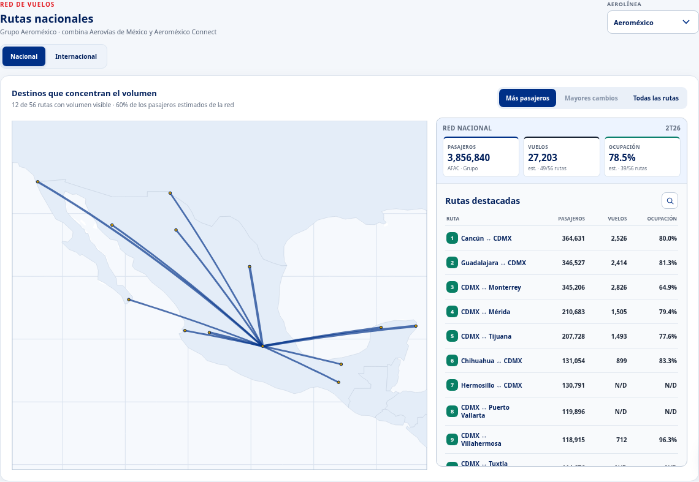
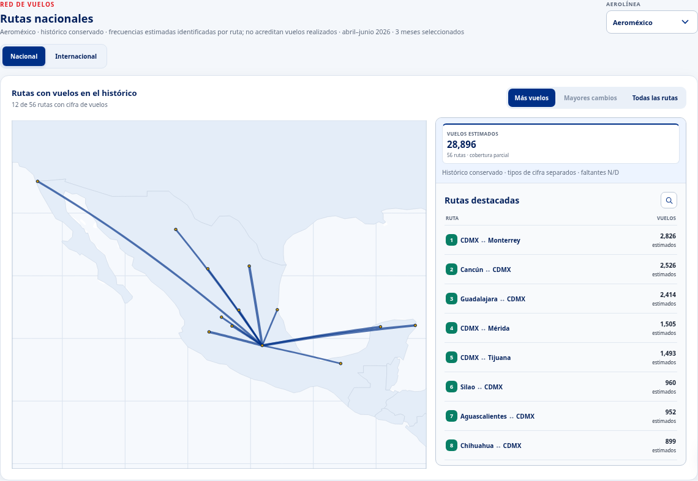

# AeroDataBox: conservamos el histórico y dejamos de capturar

Revisión del 15 de octubre de 2026. El
[PR #133](https://github.com/salvamalfa/aeromexico-tracker/pull/133) fue aprobado,
integrado como `40a63d1905` y verificado en Pages y Railway.
La [ampliación posterior de cobertura](cobertura-vuelos-20261015.md) es otra
versión de prueba y requiere su propia aprobación.

AeroDataBox aportó una semilla de oferta por ruta y operador. Combinada con
AFAC permitió estimar pasajeros; sus frecuencias y referencias de flota
permitieron estimar vuelos, asientos y ocupación. Obtuvimos semillas nacionales
marzo–agosto e internacionales abril–agosto de 2026; pasajeros ajustados hasta
julio. Agosto se capturó el 25 de septiembre. No hay semilla de septiembre.

**Dejamos las capturas por el costo recurrente de la API.** El método fue útil;
la decisión de dejar de pagar no implica que fuera técnicamente inviable.
Por decisión del dueño, **conservamos los datos que están publicados**, incluido
el histórico nacional estimado. El mapa muestra solo vuelos y distingue cifras
observadas, programadas, estimadas y atribuidas. Pasajeros, ocupación y reparto
de pasajeros dejan de mostrarse en el mapa. Las tarjetas oficiales, mezcla,
finanzas, tesis y datos históricos consultables por el chat se conservan.

## Antes

Captura real de la versión publicada, Aeroméxico, 2T26, red nacional.

## Después

La misma selección y los mismos datos históricos, mostrando únicamente vuelos.
Las estimaciones históricas siguen identificadas; no acreditan vuelos realizados.

AFAC sí publica pasajeros y vuelos por ruta agregada y por empresa por separado.
Con una semilla congelada se pueden plantear estimaciones de vuelos por compañía;
no se observan esas celdas. Un ensayo retrospectivo de un mes favoreció la semilla
más AFAC frente a añadir programación AICM, con cobertura limitada MEX–EE. UU.
Ver [prueba reproducible, límites y recomendación](../plan-salida-aerodatabox.md).

Las capturas se toman con Playwright/Chromium del cloud. El gate exige conservar
cada archivo de datos publicado byte por byte y las cuatro tesis. No hay nuevas
llamadas AeroDataBox, cambios de credenciales, suscripción ni actualizaciones
programadas. La reutilización futura de la semilla requiere revisar los términos
aplicables; la clasificación técnica de un archivo no acredita derechos.
