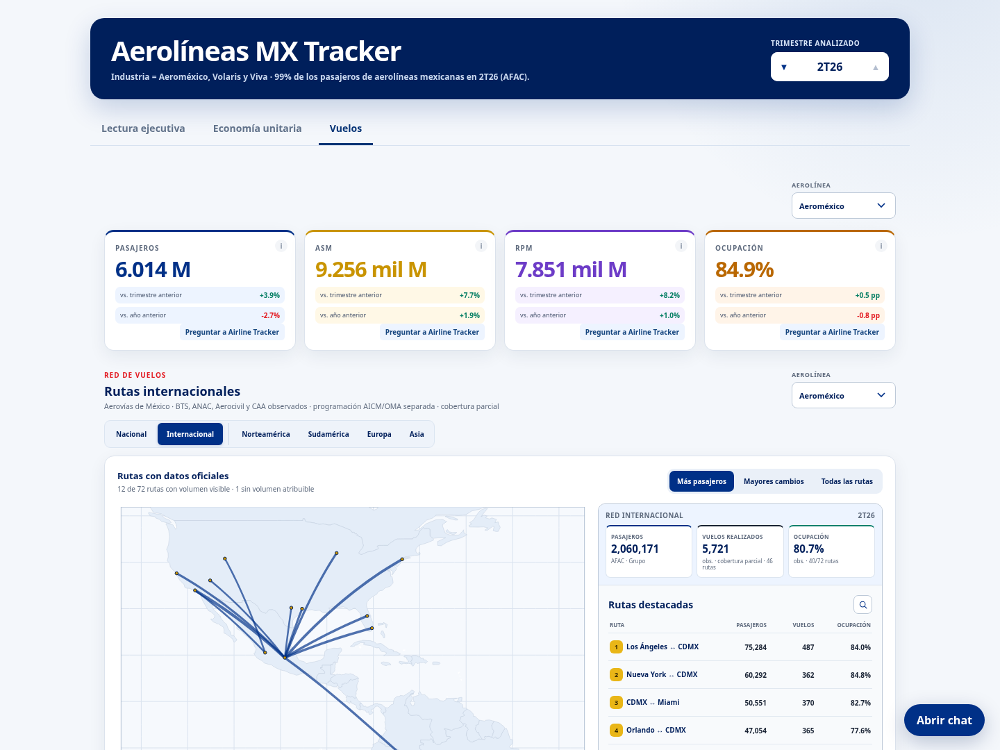

# AeroDataBox: qué conseguimos y por qué lo dejamos

14 de octubre de 2026. Cambio preparado para revisión; pendiente de aprobación
para integrarlo y publicarlo.

AeroDataBox nos permitió conocer la estructura de vuelos por ruta y operador.
La combinamos con los totales oficiales de AFAC para **estimar pasajeros por
ruta**, y con referencias de flota para estimar asientos y ocupación. Así
pudimos explorar mapas nacionales e internacionales de Aeroméxico, Volaris,
Viva y su conjunto.

Conservamos semillas nacionales de **marzo–agosto de 2026** e internacionales
de **abril–agosto**; las estimaciones de pasajeros llegaron hasta julio.
Agosto se capturó el **25 de septiembre**: fecha de captura y mes de operación
son distintos. No hay una semilla de septiembre.

El resultado era útil para explorar, pero **no observaba pasajeros por ruta**.
Reconciliar totales con AFAC no convierte una estimación en dato observado;
muestrear vuelos y expandirlos a un mes tampoco garantiza vuelos realizados.

**Decidimos dejarlo por el costo recurrente de pagar la API.** La decisión no
significa que el método fuera técnicamente inviable. El dashboard y el chat
pasan a utilizar fuentes oficiales, con la cobertura que realmente ofrecen.

## Antes

Captura real del dashboard anterior, copia de la versión publicada en
`ea88008`, tomada con Playwright/Chromium en el cloud. Aeroméxico, 2T26,
red nacional: pasajeros, vuelos y ocupación por ruta estimados.

## Después

Vista candidata con fuentes oficiales: BTS México–EE. UU., ANAC, Aerocivil y
CAA; programación AICM/OMA identificada aparte. En 2T26, BTS local cubre
abril y mayo, y falta junio. Los pasajeros agregados y las finanzas reportadas
se conservan. Nacional queda sin vuelos realizados por compañía y ruta;
la programación disponible no los reemplaza.

Los históricos privados y su linaje se conservan. Esta retirada no consume la
API, modifica credenciales ni cambia la suscripción.

Verificación local: candidato firmado por el gate; datos ajenos a Vuelos y
las cuatro tesis permanecen idénticos. Comparadas 5.130 rutas internacionales
retenidas; veinte consultas de chat comprobadas sin proveedor externo.
Navegador cloud Playwright/Chromium: cuatro entidades en escritorio y móvil,
sin errores ni desbordamiento horizontal. CI/revisión del PR pendientes;
integración y publicación requieren aprobación del dueño.
