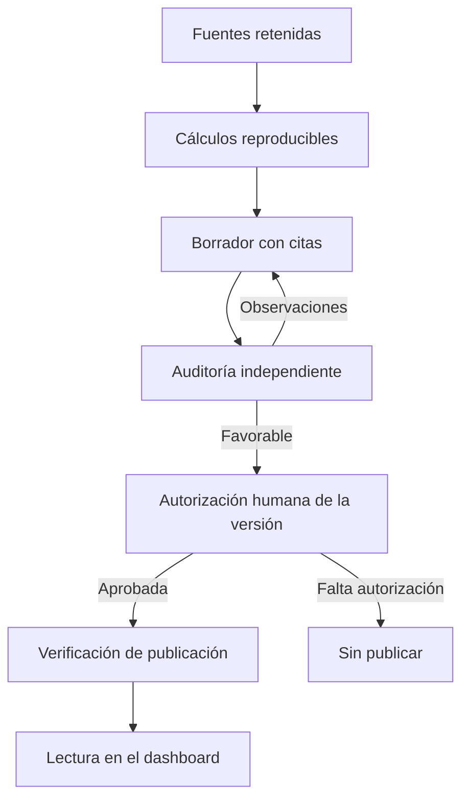

# Analysis Agent de Airlines Tracker

Este módulo convierte fuentes y cálculos verificables en lecturas trimestrales
de negocio. Separa la preparación de evidencia, la redacción, la auditoría
independiente y la autorización humana. El dashboard sólo recibe una versión
aprobada cuyo contenido y fuentes siguen coincidiendo.

## Responsabilidad



La [pauta narrativa](../../docs/analysis-agent/narrativa-trimestral.md) y la
[skill de preparación](../../.agents/skills/airline-quarterly-story/SKILL.md)
guían la investigación de una idea de negocio antes de cerrar la evidencia.
El cálculo y la revisión deben sostener las cifras y atribuciones del texto.

| Paso | Implementación |
|---|---|
| Evidencia | `evidence.py`, `flight_evidence.py`: expediente y fuentes por trimestre. |
| Cálculo | `quantitative.py`: resultados cuantitativos trazables. |
| Redacción y revisión | `analyst.py`, `stage13*.py` y prototipos `stage15_html.py`, `stage16_html.py`, `stage17_html.py`. |
| Importación por entidad | `entity_adapter.py`: paquetes privados congelados, originales, capturas verificadas y reproducción offline de extractores. |
| Aprobación | `lifecycle.py`: registro de eventos de solo apéndice en `analysis_runs/`. `consumer_payload(record)` rechaza versiones sin aprobación vigente. |
| Publicación | [`src/publish/`](../publish/README.md): vuelve a verificar el registro antes de exportar y ensamblar `site/`. |

## Entradas / salidas

Las entradas son `data/gold/`, los resultados de `src/dashboard/` y el
expediente local `analysis_runs/`. La salida del módulo es un análisis
versionado con sus fuentes, cálculos, auditoría y estado de aprobación.

`analysis_runs/` no se versiona en el repositorio público. El texto y las
citas autorizadas pueden llegar al consumidor público; los paquetes privados,
advertencias de revisión y originales retenidos permanecen fuera de `site/`.
El sitio y sus recibos los produce `src/publish/`, no este módulo.

## Identidad y promoción por entidad

Los registros nuevos usan `(entity_key, period_id, version)` y la ruta
`analysis_runs/drafts/{entity}/{period}/{version}.json`. Se conserva el formato
histórico de Aeroméxico. La auditoría, la autorización y el exportador deben
referir exactamente la misma identidad. Cambiar texto, fuentes, presentación o
implementación puede invalidar su consumo y requerir otra versión.

Importar un lote revisado del respaldo privado:

```bash
uv run python -m src.analysis_agent.entity_adapter --bundle <lote-privado>
```

Importar o preparar no aprueba ni publica. Una petición humana auténtica puede
esperar la auditoría de esa versión; falla o pierde vigencia si cambia la
versión, se rechaza la auditoría o se revoca. Nunca se reconstruye una
autorización desde el HTML. La publicación se ejecuta con
`python -m src.publish`, conforme a su [referencia](../publish/README.md).

El adaptador inicial admite Viva, Volaris e Industria para 2T26, con corte
retrospectivo de 2026-10-13. Las expectativas conservan la fecha de sus fuentes;
Industria agrupa los tres grupos con sus límites contables y geográficos.
Ampliar ese contrato exige adaptar y revisar el perfil correspondiente.

### Lectura editorial de Aeroméxico 3T26

`quarterly_release_v1` reproduce fuentes del emisor y cálculos con unidad y
duración explícitas. Distingue trimestre, acumulado, variaciones interanuales
y cifras calculadas. `analysis_editorial.schema.json` limita su contrato
adicional a Aeroméxico 3T26 y sus citas de GlobeNewswire.

La modalidad `--editorial-only` publica la lectura aprobada y sus recursos de
interfaz, conservando los demás datos. Comprueba la versión anterior y la nueva
antes del intercambio atómico. El selector de lectura es independiente del
trimestre de indicadores. Una aprobación no demuestra que el despliegue terminó.

<a id="handoff-independiente-de-viva-y-volaris-3t26"></a>

### Entrega independiente de Viva y Volaris 3T26

`issuer_quarter.py` implementa `issuer_quarter_v1`: reproduce extractores y
compara las cuatro salidas del candidato. `source_binding` vincula entidad,
periodo, corte, retención y hashes. Viva usa su PDF oficial; la versión de
Volaris de este perfil conserva el aviso autorizado de reconstrucción, sin
equipararla al original SEC.

`prepare` congela evidencia y cálculos; `import-draft` crea un borrador
inmutable. Cada entidad puede avanzar con su fuente validada, seguida de
auditoría y aprobación de su versión exacta.

### Perfil versionado de historias de negocio

`quarterly_story.py` implementa `quarterly_business_story_v1` para las cuatro
historias revisadas de 3T26. Resumen y desarrollo suman 200–400 palabras; la
pauta general para propuestas nuevas prefiere 200–300. Los contratos
históricos no se reescriben.

Las cifras y atribuciones se resuelven desde paquetes cerrados y verificadores
de fuente. Una comparación estructural impide cambiar texto, cifras, énfasis
o colocación después de importar. Las citas públicas contienen URL, título,
ancla y etiqueta. La skill narrativa y su hash forman parte del borrador.

Volaris admite el paquete `volaris_original_quarter_v1`, reproducido desde
cuatro capturas HTTP de SEC. Es una identidad distinta de la reconstrucción
anterior y requiere su propia auditoría y autorización. Si el host no ofrece
un identificador verificable, el modelo se registra como desconocido.

La entrega prepara cada tesis y una candidata de Industria para revisión.
No activa evidencia, aprueba datos ni publica por el hecho de generar contexto.

## Puntos de entrada

Las etapas individuales usan `just stage12-*` a `just stage16-*` del
[`justfile`](../../justfile). El [mapa del repositorio](../../REPO_MAP.md)
reúne los comandos y el [módulo de publicación](../publish/README.md) documenta
la entrega a Pages.

## Comando de prueba focalizada

```bash
uv run pytest -q tests/test_stage17_lifecycle.py tests/test_stage18_literal_contract.py
```