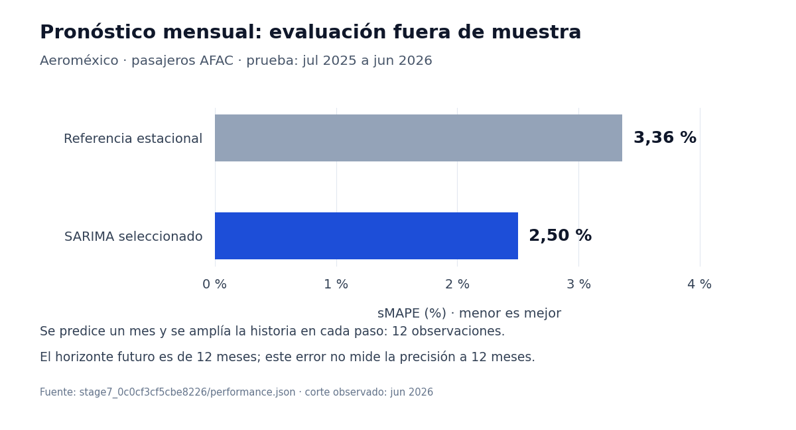

# Modelos y estudios de Airlines Tracker

Esta capa convierte las tablas Gold en pronósticos, grupos de rutas y señales
para investigar. Combina modelos estadísticos, aprendizaje no supervisado y
análisis de texto; cada técnica responde una pregunta distinta.

## Responsabilidad

| Problema | Método | Cómo se evalúa | Límite principal |
|---|---|---|---|
| Anticipar pasajeros mensuales de Aeroméxico | [SARIMA y suavizado exponencial ETS](forecast.py), frente a referencias simples | Validación temporal, prueba posterior y errores de pronóstico | La evaluación es a un mes; el horizonte futuro es de doce meses. |
| Identificar rutas con patrones similares | [KMeans](clustering.py) sobre variables estandarizadas; PCA para representación | Separación de grupos y estabilidad entre inicializaciones | Agrupación descriptiva; no predice demanda ni demuestra impacto comercial. |
| Encontrar observaciones inusuales | [Residuos estacionales, puntuaciones robustas y distancias PCA](anomalies.py) | Reglas explícitas y contexto de eventos | Una señal no confirma un error ni su causa. |
| Explorar el lenguaje de reportes | [TF-IDF y diccionario financiero Loughran–McDonald](nlp_reports.py) | Términos, tono y cambios observados en el corpus | Análisis descriptivo de pocos documentos, sin clasificador entrenado. |
| Estimar pasajeros por ruta y aerolínea | [Ajuste proporcional iterativo](route_carrier.py) con totales observados | Reconstrucción de celdas ocultas y reconciliación de totales | Estima un reparto contemporáneo; no pronostica ni observa cada celda. |

La [guía metodológica de estimaciones](../../docs/estimacion-pasajeros-ruta-aerolinea.md)
describe los insumos, cobertura, ceros y criterios de aceptación del último método.
Los [estudios de negocio](studies/) cubren comparaciones entre aerolíneas,
estacionalidad, concentración, combustible y eventos.

## Pronóstico: del objetivo a la evaluación

El objetivo es el total mensual de pasajeros AFAC de Aeroméxico. Se requieren
al menos 60 meses completos. La serie conserva el periodo de COVID y utiliza
su propia historia, tendencia y estacionalidad; no incorpora variables externas.

1. **Referencias:** último valor (`naive`), mismo mes del año anterior
   (`seasonal_naive`) y tendencia lineal entre extremos (`drift`).
2. **Candidatos estadísticos:** ETS con tendencia amortiguada y
   SARIMA(1,1,1)(0,1,1,12).
3. **Validación:** los doce meses anteriores a la prueba sirven para elegir
   entre ETS y SARIMA por error porcentual absoluto simétrico, sMAPE.
4. **Prueba:** los últimos doce meses se evalúan después de esa elección.
   En cada mes se amplía el entrenamiento con la historia disponible y se
   predice únicamente el mes siguiente.
5. **Regla de publicación analítica:** el candidato elegido se conserva como
   pronóstico publicable si supera a la referencia estacional en la prueba.
   Después se ajusta con toda la serie para producir doce meses futuros.

La prueba también condiciona la publicación del modelo: sus resultados deben
interpretarse junto con esa regla de selección, no como garantía de desempeño
futuro.

### Resultado conservado en el repositorio

La corrida [`stage7_0c0cf3cf5cbe8226`](../../models/stage7_0c0cf3cf5cbe8226/metadata.json)
evalúa julio de 2025 a junio de 2026, con doce observaciones de prueba.
Los valores siguientes proceden de [su archivo de métricas](../../models/stage7_0c0cf3cf5cbe8226/performance.json).



La [versión vectorial](../../docs/assets/analytics/evaluacion-pronostico.svg)
conserva las etiquetas al ampliar. Para regenerar las figuras desde las métricas
versionadas, añade Matplotlib al entorno de ejecución; Pillow ya forma parte
del entorno bloqueado del proyecto:

```bash
uv run --with matplotlib==3.10.9 python scripts/render_documentation_visuals.py
```

La primera ejecución puede descargar dependencias. El generador sólo lee
artefactos versionados: no descarga fuentes ni entrena modelos. Para generar
únicamente el diagrama SVG, sin dependencias gráficas:

```bash
python scripts/render_documentation_visuals.py --flow-only
```

| Modelo | sMAPE de prueba | Error absoluto medio, pasajeros |
|---|---:|---:|
| Último valor | 8,35 % | 165.692 |
| Referencia estacional | 3,36 % | 68.362 |
| Tendencia lineal | 8,36 % | 165.929 |
| ETS amortiguado | 4,98 % | 97.997 |
| SARIMA seleccionado | 2,50 % | 48.930 |

**El 2,50 % mide predicciones a un mes.** No demuestra ese error a doce meses.
Es el resultado de esa corrida conservada, no una nueva evaluación sobre cada
actualización posterior de AFAC. También se guardan MAPE, raíz del error
cuadrático medio (RMSE) y error absoluto escalado (MASE).

Los intervalos del 80 % y 95 % usan el error estándar y una aproximación normal.
Los controles verifican su orden; no acreditan cobertura empírica de esos
intervalos.

### Qué ve el usuario

El pronóstico existe en Gold y en su exportación, pero **todavía no tiene una
gráfica montada en el dashboard**. Otros estudios se conservan como análisis
precomputados. El [mapa de exposición de Gold](../../docs/gold-exposure.md)
distingue datos visibles, contexto y salidas analíticas.

## Agrupación de rutas

[clustering.py](clustering.py) trabaja con observaciones ruta-año de Aeroméxico.
Usa distancia, frecuencia, asientos, ocupación, variación estacional, competidores
y tipo de aeronave. Primero estandariza las variables y compara de dos a seis
grupos KMeans; exige al menos cinco observaciones por grupo y elige la mayor
puntuación de silueta, que mide su separación.

La estabilidad se mide con el índice de Rand ajustado (ARI) entre siete semillas.
Esto comprueba sensibilidad a la inicialización, no estabilidad temporal.
PCA reduce las variables a dos ejes para representarlas. Los ejercicios de
trimestres tienen requisitos propios y pueden quedar sin resultado por falta
de datos o grupos estables.

## Entradas / salidas

- **Entradas:** tablas `data/gold/*.parquet` y vistas de `data/warehouse.duckdb`.
- **Salidas principales:** `fact_forecasts`, `dim_model_performance`,
  `dim_cluster_assignments`, `fact_anomalies`, `fact_report_language` y
  `fact_study_results`.
- **Evidencia:** configuración y desempeño bajo `models/`; diagnósticos locales
  bajo `data/analytics/`; [hallazgos](../../docs/analytics/hallazgos.md) y notebook
  generados por la ejecución analítica.

[common.py](common.py) identifica las corridas con huellas de datos, código y
configuración. [validate_stage7.py](validate_stage7.py) comprueba contratos,
fechas de entrenamiento y reglas analíticas. Reproducir una corrida requiere
sus insumos locales; el clon público no contiene todo el respaldo original.

## Puntos de entrada

Desde la raíz, con las dependencias analíticas y el warehouse preparados:

```bash
uv run python -m src.analytics
```

Este comando recalcula tablas, métricas, hallazgos y notebook; no publica el
sitio. Los estimadores tienen entradas específicas, por ejemplo:

```bash
uv run python -m src.analytics.route_carrier
```

Consulta la guía metodológica antes de ejecutar un estimador o cambiar sus
insumos. [build_notebook.py](build_notebook.py) genera el notebook exploratorio;
[eda.py](eda.py) y [reporting.py](reporting.py) preparan sus análisis y reportes.

## Comando de prueba focalizada

```bash
uv run pytest -q tests/test_stage7.py tests/test_route_carrier_ipf.py tests/test_international_route_carrier.py
```

Las pruebas marcadas `local_data` requieren los insumos locales que indiquen.
