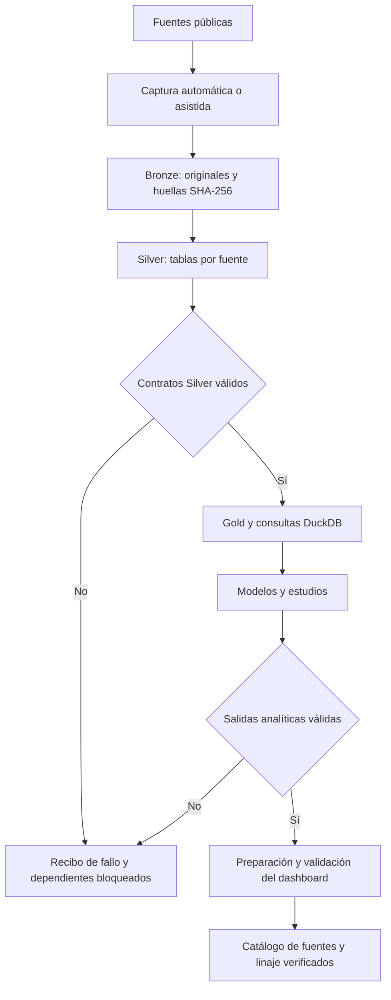

# Pipeline de datos de Airlines Tracker

Este módulo coordina la captura de fuentes, la construcción de tablas y los
controles que preparan los datos del dashboard. Cada paso declara sus insumos,
dependencias y salidas; la ejecución deja un recibo con estado, duración y motivo.

## Recorrido de los datos

Bronze conserva los originales; Silver organiza cada fuente en tablas; Gold
reúne métricas y dimensiones comparables. Los modelos y el dashboard consumen
esa base validada.



El diagrama resume el recorrido; [el registro](registry.py) fija el orden y las
dependencias exactas, incluidos los controles Gold. La publicación del sitio
ocurre después mediante [su propio proceso](../publish/README.md).
La [vista general del sistema](../../docs/assets/architecture/flujo-datos.svg)
sitúa el pipeline junto al dashboard y al chat.

## Responsabilidad

| Pieza | Para qué sirve |
|---|---|
| [registry.py](registry.py) | Declara las fases, acciones, requisitos y productos esperados. |
| [runner.py](runner.py) | Comprueba insumos, ejecuta acciones y escribe recibos. |
| [model.py](model.py) | Define los estados y la estructura de cada paso y recibo. |
| [offline.py](offline.py) | Bloquea la red durante la reconstrucción local. |
| [actions.py](actions.py) y [worker.py](worker.py) | Adaptan acciones del proyecto y permiten ejecutar un paso aislado. |

Una entrada ausente queda identificada como fallo o como no disponible, según
su obligatoriedad. Un fallo bloquea los pasos que dependen de él; los fallos
obligatorios hacen fallar la ejecución. Los recibos se guardan en
`data/quality/pipeline_runs/` incluso cuando hay errores.

## Entradas / salidas

- **Entradas:** fuentes capturadas, tablas disponibles y requisitos del registro.
- **Salidas:** Bronze, Silver, Gold, estudios y datos preparados para el dashboard,
  según las fases seleccionadas, más el recibo de ejecución.
- **Reproducibilidad:** la reconstrucción usa una copia aislada de Bronze y
  bloquea la red. Requiere los originales locales; el clon público conserva
  extractos Gold, pero no incluye todos los insumos para reconstruirlos.

AFAC conserva actualización asistida. El
[workflow de frescura](../../.github/workflows/refresh.yml) revisa antigüedad y
valida Gold; la descarga completa de todas las fuentes no ocurre allí.
El calendario de fuentes tiene [su propio coordinador](../../docs/calendario-ejecucion.md).

## Puntos de entrada

Ejecuta los comandos desde la raíz. Cada comando selecciona una fase; no
publica el sitio.

| Comando | Alcance |
|---|---|
| `just ingest` | Captura de fuentes con red y requisitos propios de cada proveedor. |
| `just parse` | Bronze a Silver, sin red. |
| `just transform` | Silver a Gold y sus validaciones, sin red. |
| `just rebuild` | Reconstrucción aislada desde Bronze, con analítica y preparación del dashboard. |

Las entradas Python equivalentes son `python -m src.ingest`,
`python -m src.parse`, `python -m src.transform` y `python -m src.rebuild`.
Este paquete no tiene una CLI propia.

## Comando de prueba focalizada

```bash
uv run pytest -q tests/test_pipeline_orchestration.py
```

Consulta el [mapa del repositorio](../../REPO_MAP.md) para seguir los productores
y consumidores de cada salida.
